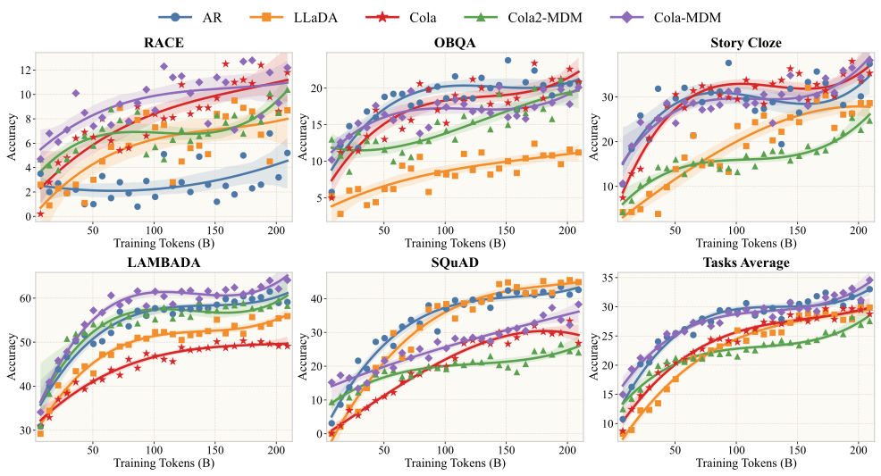
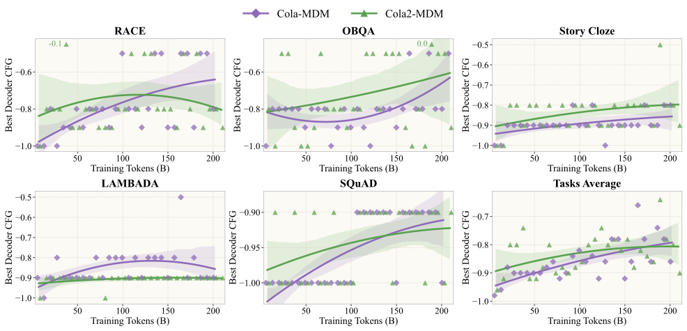

# Cola2

Cola2 是一个让语义压缩与离散文本生成协同适配的连续 latent 语言模型。模型由
动态压缩 VAE、block-causal Diffusion Transformer（DiT）、span-causal token
decoder 和 latent feedback 组成。

[English](README.md) ·
[论文](https://arxiv.org/abs/2610.31305) ·
[项目主页](https://hongcanguo.github.io/Cola2/) ·
模型与 benchmark 文件：**即将发布**

## 项目简介

配套论文题为 **“Cola2: Co-Adaptive Hierarchical Language Modeling with
Continuous Semantic Compression and Balanced Discrete Generation”**。
Cola2 将文本动态划分为语义 span，用紧凑的连续 latent 表示每个 span，通过 DiT
生成 latent block，再将 latent 实现为离散 token。

论文所报告的 checkpoint 使用 346.03B source tokens 训练，在八项评测上的平均
成绩为 60.10。这些数字是论文报告结果，并不表示每次本地运行都会得到完全相同的
数值。

本仓库提供：

- 仅用于推理、兼容 Hugging Face Transformers 的实现；
- 配置、命令行工具、示例和 CPU 单元测试；
- 支持断点续跑的八任务 benchmark 与 scorer；
- 论文结果的 Markdown 和机器可读副本。

本仓库不包含训练代码、模型权重、tokenizer 或 benchmark JSONL。Checkpoint 和
归一化 benchmark 文件将在同一个 Hugging Face 仓库中发布。

## 项目讲解

<video src="assets/videos/cola2-v2-motion-bgm-1080p.mp4" controls width="100%">
  当前浏览器不支持内嵌视频。
</video>

[▶ 播放或下载 Cola2 讲解视频](assets/videos/cola2-v2-motion-bgm-1080p.mp4)
· [打开交互式项目主页](https://hongcanguo.github.io/Cola2/)

## 方法


Stage I 联合训练动态压缩 encoder 与 token decoder。Stage II 在 token 侧监督下
继续适配 VAE，同时由约 4B 参数的 DiT 通过 Flow Matching 学习 stop-gradient
后的 latent 分布。推理时，Cola2 反复执行 latent block 生成、token 解码和固定
span layout 下的已生成文本重编码，使连续与离散历史始终对齐。

## 受控 Scaling 实验

受控实验在相同模型规模、数据和评测设置下比较 AR、LLaDA、Cola DLM、
未压缩 Cola-MDM 与压缩后的 Cola2-MDM。Cola-MDM 的总体 scaling 最强；
Cola2-MDM 收敛较慢，但在约 150B tokens 后持续缩小与 LLaDA 的差距，并且到约
210B tokens 时仍未饱和。



最优 decoder classifier-free-guidance 权重在大部分训练期间保持在 `-0.9`
附近，并随训练逐渐向零移动。



## Post-pretraining 结果

资源受限的 checkpoint 使用 346.03B source tokens。其 latent DiT 尚未收敛，
但 Cola2 已取得 60.10 的八任务平均分；在报告的预训练 token 少 43 倍以上的
情况下，HellaSwag 和 StoryCloze 仍超过 Llama-3-8B。

| 任务 | Llama-3-8B | Qwen2.5-7B | Qwen3-8B-Base | LLaDA-8B-Base | **Cola2** |
|---|---:|---:|---:|---:|---:|
| 预训练 tokens | 15T+ | 18T | ~36T | 2.3T | **346B** |
| RACE | 75.77 | 89.95 | 90.65 | 87.40 | **69.91** |
| NarrativeQA | 42.70 | 32.90 | 37.30 | 36.00 | **32.70** |
| HellaSwag | 39.21 | 75.67 | 68.13 | 69.65 | **41.75** |
| StoryCloze | 79.49 | 95.09 | 97.44 | 95.94 | **80.42** |
| LAMBADA | 75.70 | 71.82 | 71.20 | 67.90 | **63.00** |
| ARC-Easy | 90.86 | 96.00 | 97.35 | 93.85 | **87.62** |
| TruthfulQA | 63.04 | 69.03 | 72.58 | 64.87 | **54.10** |
| MMLU | 63.19 | 70.16 | 72.31 | 61.27 | **51.32** |
| **八任务平均** | **66.25** | **75.08** | **75.87** | **72.11** | **60.10** |

除 token 行外，其余数值均为准确率（%）。各模型采用不同的训练配方、
tokenizer 和 token 统计方式，因此该表用于说明能力水平，而不是单独比较生成
范式。每项 Cola2 成绩均为三次 latent-noise sampled evaluation 的均值；详见
[参考结果](eval_output/full_test_results.md)和[复现协议](docs/reproduction_zh.md)。

## 安装

进入源码目录后执行：

```bash
python -m venv .venv
source .venv/bin/activate
python -m pip install --upgrade pip
python -m pip install -e .
```

项目要求 Python 3.10+、PyTorch 2.2+、Transformers 4.51–4.x 和
safetensors 0.4+。Checkpoint 推理建议使用支持 bfloat16 的 CUDA 环境。开发与
测试依赖可通过 `python -m pip install -e ".[test]"` 安装。
Wheel 仅包含推理包；benchmark 模块与脚本需要从源码 checkout 中运行。

## 模型文件

Hugging Face 发布地址**即将提供**。下载 Transformers snapshot 后，将
`COLA2_MODEL_PATH` 指向本地目录：

```bash
export COLA2_MODEL_PATH=/path/to/cola2
```

模型目录应包含 safetensors 权重分片、tokenizer、`config.json`、
`generation_config.json`、remote-code 模块和 `SHA256SUMS`。使用前请根据
`SHA256SUMS` 校验下载文件。

## 快速调用

```python
import torch
from transformers import AutoModel, AutoTokenizer

model_id = "/path/to/cola2"
tokenizer = AutoTokenizer.from_pretrained(model_id, trust_remote_code=True)
model = AutoModel.from_pretrained(
    model_id,
    trust_remote_code=True,
    torch_dtype=torch.bfloat16,
    low_cpu_mem_usage=True,
).to("cuda").eval()

prompt = "Question: What is the capital of France? Answer:"
inputs = tokenizer(prompt, return_tensors="pt").to(model.device)
generator = torch.Generator(device=model.device).manual_seed(42)

with torch.inference_mode():
    output = model.generate(**inputs, generator=generator)

answer = tokenizer.decode(
    output[0, inputs.input_ids.shape[1] :],
    skip_special_tokens=True,
)
print(answer)
```

不传覆盖参数时，`generate()` 使用发布 preset：8 步 low-noise-biased Euler
DiT、DiT CFG 10、decoder CFG -0.9、每个 decoder chunk 一个 latent span、
dynamic duration、latent feedback、greedy token selection 和
`max_new_tokens=32`。Greedy token selection 不代表整个模型是确定性的，因为
latent generation 从高斯噪声开始；比较输出时应传入固定 seed 的
`torch.Generator`。

## 命令行

```bash
COLA2_MODEL_PATH=/path/to/cola2 bash scripts/run_chat.sh
```

输入 `/reset` 清空本地历史，输入 `/quit` 退出。Cola2 是 base model，不是经过
instruction tuning 的聊天助手。

## 评测

归一化 benchmark JSONL 将随 Hugging Face 模型一起发布。下载后放入
`eval_data/`，或设置 `GENERATE_TASK_DATA_DIR=/path/to/eval_data`。发布前数据
链接明确保留为**即将发布**。

运行每项任务 200 条样本的 smoke benchmark：

```bash
export COLA2_MODEL_PATH=/path/to/cola2
export GENERATE_TASK_DATA_DIR=/path/to/eval_data
bash scripts/run_benchmark_quick.sh --models cola2
```

运行完整固定评测矩阵：

```bash
export COLA2_MODEL_PATH=/path/to/cola2
export LLAMA3_MODEL_PATH=meta-llama/Meta-Llama-3-8B
export QWEN25_MODEL_PATH=Qwen/Qwen2.5-7B
export QWEN3_MODEL_PATH=Qwen/Qwen3-8B-Base
export LLADA_MODEL_PATH=GSAI-ML/LLaDA-8B-Base
bash scripts/run_benchmark_all.sh --max-samples 0
```

论文中每项 Cola2 成绩是三次 latent-noise sampled evaluation 的均值。可使用
`scripts/run_benchmark_paper.sh` 执行对应的三 seed 公开协议。论文原始 seed
尚未公布，因此本地结果与[参考结果](eval_output/full_test_results.md)之间可能
存在小幅数值差异。

## 文档

- [文档索引](docs/README_zh.md)
- [论文概览](docs/paper_zh.md)
- [架构](docs/architecture_zh.md)
- [推理](docs/inference_zh.md)
- [配置](docs/configuration_zh.md)
- [评测](docs/benchmark_zh.md)
- [复现协议](docs/reproduction_zh.md)
- [模型卡](docs/model_card_zh.md)
- [贡献指南](CONTRIBUTING.md)
- [安全政策](SECURITY.md)

## 引用

请引用 [Cola2 arXiv 论文](https://arxiv.org/abs/2610.31305)。BibTeX 与机器
可读元数据见 [CITATION.md](CITATION.md) 和 `CITATION.cff`。

## 许可证

仓库代码采用 [Apache License 2.0](LICENSE)。模型权重、tokenizer、
benchmark 数据集和其他第三方素材仍分别遵循其适用条款。归属信息见
[NOTICE](NOTICE)。
